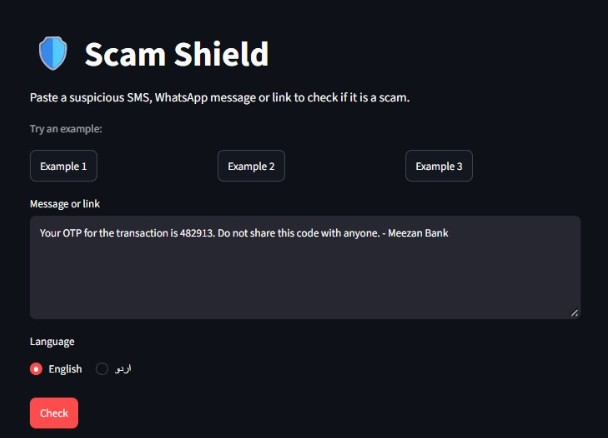
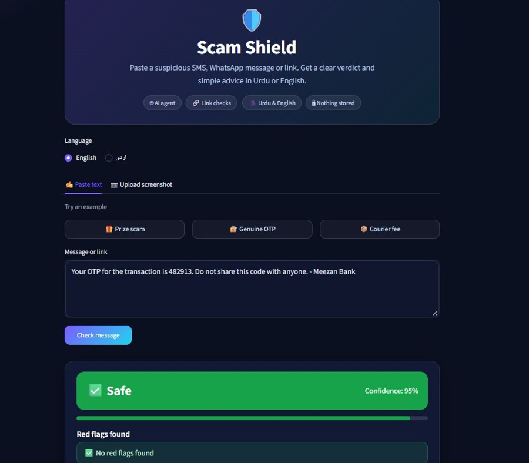
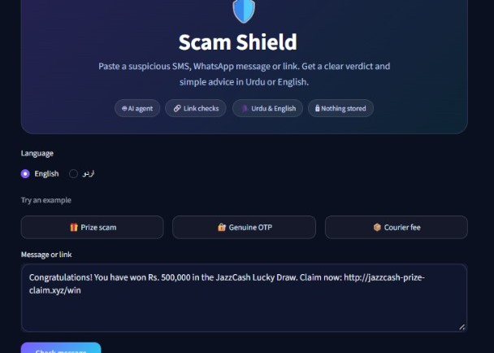
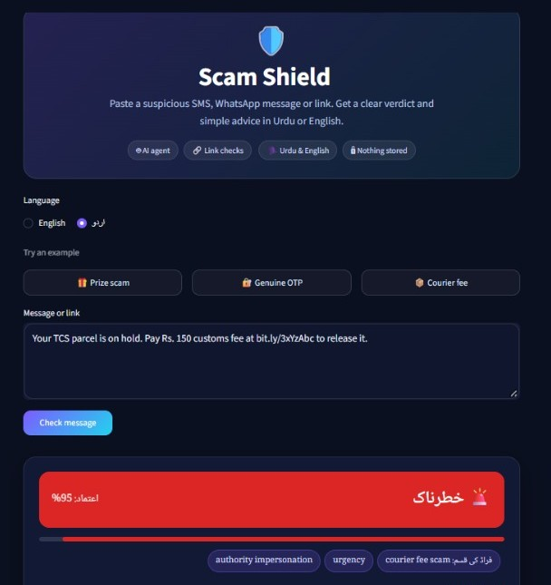
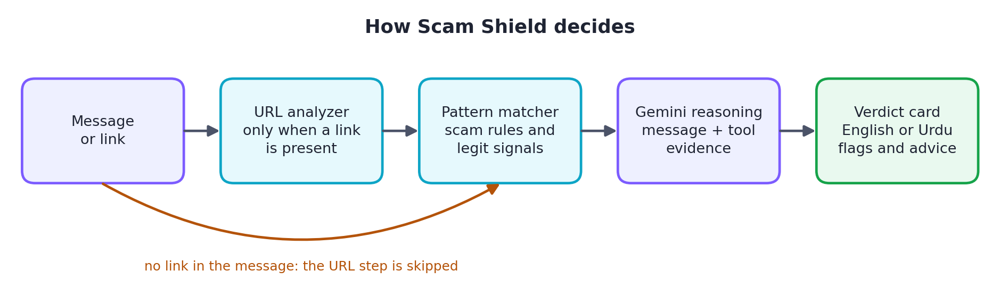

<div align="center">

# 🛡️ Scam Shield

**An AI agent that checks suspicious SMS, WhatsApp messages and links, and explains in simple Urdu or English why they look like scams.**

[](https://scamshieldapp-gw873grbsmcqdnx8p7qhet.streamlit.app/#scam-shield)


<sub>On the free hosting plan the app may be asleep, so the first load can take up to a minute.</sub>

</div>

---

## 📌 The problem

Scams in Pakistan spread mainly through SMS, WhatsApp and fake links: fake prize messages in the name of mobile wallets, fake bank alerts, "your account will be blocked" threats, courier fee scams and fake job offers. Many victims cannot tell a real message from a fake one, and no simple tool explains *why* something is suspicious in their own language.

## 💡 The solution

Paste a message or link, pick Urdu or English, and get an answer in seconds:

| You get | Example |
|---|---|
| **Risk level** with a confidence score | Safe / Suspicious / Dangerous |
| **Red flags found** | "creates false urgency", "link domain does not match the claimed sender" |
| **Plain-language explanation** | why the message looks like a scam, or why it looks genuine |
| **What to do next** | don't click, never share an OTP, contact the bank on its official number |
| **Learn more** | a short note on how this type of scam works |

## 📸 Screenshots

<table><tr><td align="center" valign="top" width="25%"><br><sub>Paste a message, pick a language</sub></td><td align="center" valign="top" width="25%"><br><sub>A genuine OTP message is marked Safe</sub></td><td align="center" valign="top" width="25%"><br><sub>A fake prize message is marked Dangerous</sub></td><td align="center" valign="top" width="25%"><br><sub>The same result in Urdu</sub></td></tr></table>

## 🧠 How it works

The agent decides which tools to call based on the input (no link means no URL check), then combines the evidence in one reasoning step.

<p align="center"></p>

1. **URL analyzer (pure Python):** finds links and checks lookalike domains against official brand domains, URL shorteners, IP-address links, suspicious domain endings, subdomain count, HTTPS, and domain age via WHOIS.
2. **Pattern matcher (rules and regex):** local scam types such as prize/lottery, wallet and bank impersonation, OTP requests, courier fees, job offers and government payment schemes, plus signals of legitimate messages.
3. **Reasoning step (LLM):** Gemini receives the original message and all tool outputs and returns a structured JSON verdict. The tool findings are evidence for the model, so it does not simply guess.
4. **Output formatter:** the web UI renders the verdict in the chosen language, right to left for Urdu.

**Prompt and output design.** The prompt tells the model to judge what a message asks the user to do, not just whether it mentions a bank or courier, which is meant to avoid false alarms on genuine OTPs and bank alerts. The model must return JSON that matches a fixed schema (risk, confidence, scam type, tactics, flags, explanation, advice, learn-more), enforced with Gemini's structured-output feature, so the UI never parses free text. The model gets the tool findings as evidence and is told to weigh them rather than trust them blindly. A prompt rule forbids inventing phone numbers, helplines or websites, so users are sent to "the official number on the back of your card or the official website". Temperature is 0 for repeatable results.

## ✨ Features

- Text input in English, Roman Urdu or Urdu script
- Urdu and English output
- Evidence from tools, not only the model's opinion
- The app does not store messages

## 🧰 Tech stack and AI usage

| Part | Tool |
|---|---|
| LLM | **Google Gemini API**, model `gemini-3.1-flash-lite` (free tier): reasoning, structured JSON output, Urdu generation |
| Agent logic | Python functions |
| URL checks | `tldextract`, `python-whois` |
| Web UI | Streamlit (live demo), Gradio (alternative `app.py`) |
| Hosting | Streamlit Community Cloud |
| Development | Google Colab, GitHub |

AI coding assistants were used as development helpers. We tested and reviewed the code ourselves.

## 📊 Evaluation

We tested on 50 messages, using the same model (`gemini-3.1-flash-lite`) for every run. "Suspicious" counts as a scam prediction.

| Test set | Mode | Accuracy | Precision | Recall | False-positive rate |
|---|---|---|---|---|---|
| Main (40: 20 scam, 20 legit) | LLM only | 100% | 100% | 100% | 0% |
| Main (40: 20 scam, 20 legit) | LLM + tools | 100% | 100% | 100% | 0% |
| Hard (10: 5 scam, 5 legit) | LLM only | 100% | 100% | 100% | 0% |
| Hard (10: 5 scam, 5 legit) | LLM + tools | 100% | 100% | 100% | 0% |

> **What this means:** the tools did not change accuracy on our data, since both modes classified every message correctly. The test messages were written by us as realistic examples based on common scam patterns, so they are cleaner than real-world messages and this is not a real-world accuracy figure. The tools add evidence and explainability: for example the registered domain, a lookalike match against the official brand domain and the domain age, none of which the model can verify on its own.

Test sets and raw results are in the [`data/`](data/) folder.

## ⚠️ Limitations

- Small test set, mostly written by us. Real scams are messier, so real-world accuracy is unknown.
- The list of official brand domains is hand-made and incomplete.
- WHOIS lookups can fail or time out, so domain age is sometimes missing.
- The free Gemini tier has a daily request limit, so the live demo can show a "busy" message.
- Messages are sent to Google's Gemini API for analysis. The app does not store them, but check Google's terms for free-tier data use.
- This is an assistant, not a replacement for reporting scams to the authorities. Always verify through the official channel.

## 🗂️ Project structure
```
├── agent/
│   ├── core.py          # agent pipeline: decides which tools to call
│   ├── url_tools.py     # URL analyzer
│   ├── patterns.py      # pattern matcher
│   └── llm.py           # Gemini call and structured JSON verdict
├── streamlit_app.py     # web UI (live demo)
├── app.py               # Gradio version of the UI
├── data/                # test sets and evaluation results
└── requirements.txt
```

## 🚀 Setup

<details>
<summary>Run it yourself</summary>

1. Clone the repository.
2. `pip install -r requirements.txt`
3. Set the environment variables (do **not** commit real keys): `GEMINI_API_KEY`, and optionally `GEMINI_MODEL` (we used `gemini-3.1-flash-lite`).
4. Run `streamlit run streamlit_app.py` (or `python app.py` for the Gradio version).

</details>

## 👥 Team

| Who | Contribution |
|---|---|
| **Ayesha Zulfiqar** ([@ayeshaazulfiqar](https://github.com/ayeshaazulfiqar)) | Backend agent, Gemini integration, URL analyzer, pattern matcher |
| **Laiba Khan** ([@laibakh4n](https://github.com/laibakh4n)) | Test set, web UI, evaluation, deployment, demo video |

Built for the NYLP AI Hackathon 2026.
